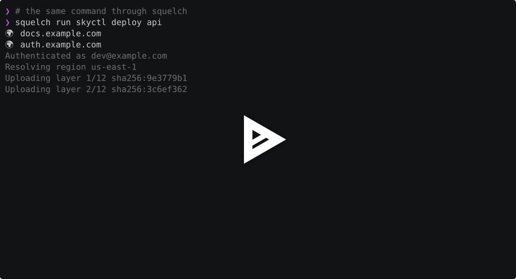

# Overview

squelch runs a command and keeps its stderr out of the way. It's meant for tools that bury you in progress messages and warnings on stderr, but it works with any command.

While the command runs, squelch shows the last four non-blank lines of stderr, dimmed, beneath the command's output. Above them it lists each link found in stderr as a 🌍 and the link's domain, clickable in terminals that support OSC 8 hyperlinks.

When the command exits, the live view disappears. If the command succeeded, its stderr is discarded. If it failed, squelch prints the full stderr and exits the same way the command did, with the same exit code or by the same signal.

The command gets squelch's stdin. If stdout is piped or redirected, squelch draws on stderr instead and the command's output passes through untouched. If neither is a terminal, squelch skips the live view and just holds stderr back until it knows whether the command failed.

# Demo

[](https://asciinema.org/a/ZpQG6MNcTSz8sgro)

The demo runs `demo/skyctl`, a pretend deploy tool, first on its own and then through squelch. `demo/demo.sh` drives the recording.

# Installation

```sh
go install github.com/collinvandyck/squelch/cmd/squelch@latest
```

Or, from a clone:

```sh
just install
```

# Usage

Run a command through squelch with `run`. Everything after the command name goes to the command:

```sh
squelch run gcloud compute instances list --format=json
```

To use squelch every time you run a command, add this to your `.zshrc` after `compinit`:

```sh
eval "$(squelch init zsh --cmd gcloud)"
```

This aliases `gcloud` to `squelch run gcloud` and sets up completion so that tab completion for `gcloud` still works. Repeat `--cmd` to wrap more commands. `init` includes squelch's own completion, so don't also load `squelch completion zsh`, which would take back completion for `squelch` and turn off the passthrough.

Only zsh is supported for now.
